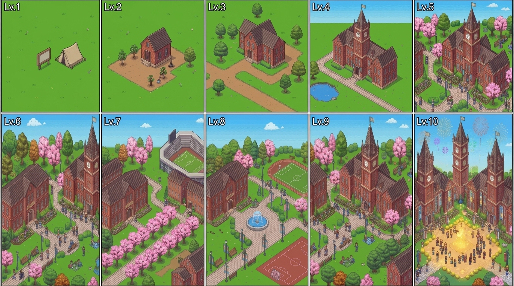
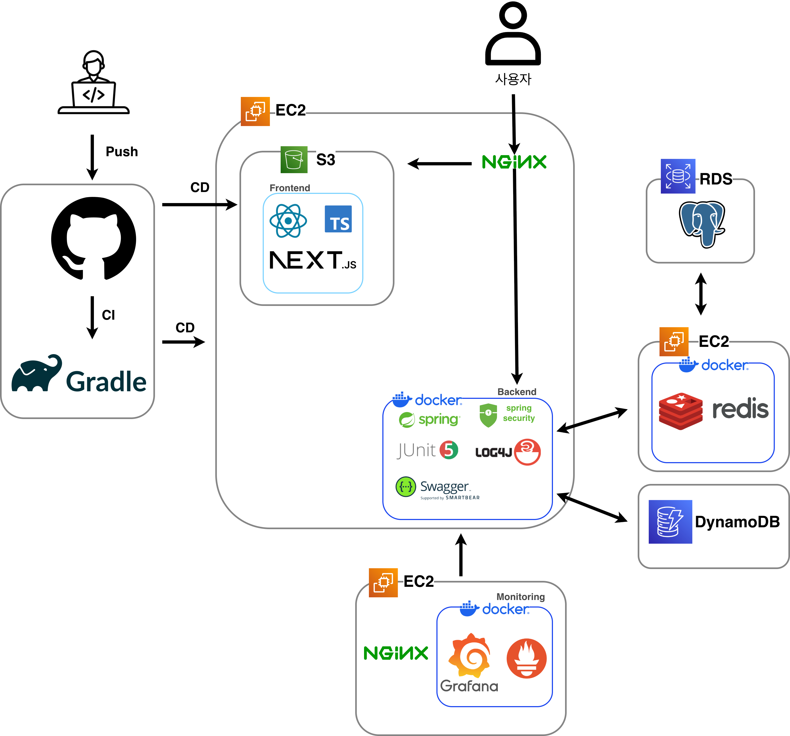
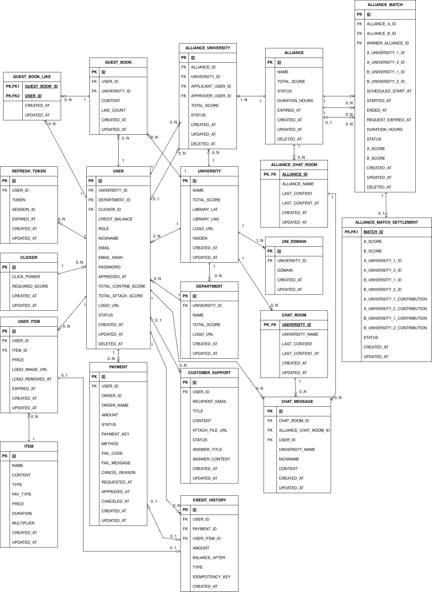

<div align="center">


**대학교 대 대학교, 클릭으로 겨루는 실시간 캠퍼스 대항전**



</div>

## 서비스 소개

**대대대**는 대학생이 학교 이메일로 인증하고, 클릭으로 우리 학교의 순위를 끌어올리는 캠퍼스 대항전입니다.
내가 클릭할 때마다 학교·학과·개인 점수가 함께 오르고, 학교 점수가 쌓일수록 캠퍼스가 텐트 하나에서 시계탑과 축제 광장까지 자라납니다.

혼자 누르는 게임이 아닙니다. 다른 학교를 공격해 점수를 깎고, 연합을 맺은 학교에는 점수를 보태고, 연합끼리 시간을 정해 대결합니다.
모은 기여도로 클리커를 업그레이드하거나 물약을 사서 더 세게 클릭할 수 있고, 학교·연합 채팅방에서 같은 편끼리 작전을 짤 수 있습니다.

## 팀 시큼이들

|  |  |  |  |
|:---:|:---:|:---:|:---:|
| [박현호](https://github.com/PHH1123) (팀장) | [김재철](https://github.com/Lemnoideae) | [나희원](https://github.com/lion1230) | [최훈희](https://github.com/hunhee99) |
| 클릭·점수 엔진,<br/>모니터링·부하 테스트,<br/>CD·AWS 배포 | 회원·인증·채팅·문의 | 학교·랭킹·연합 | 클리커·상점·결제,<br/>CI |

## 기술 스택

| 분야 | 기술 |
|---|---|
| Backend |      |
| Data |     |
| Frontend |      |
| Infra |     |
| Test |   |

## 아키텍처



## ERD



## 프로젝트 구조

```
├── src
│   ├── main
│   │   ├── java/com/back/nbe1214finalsour
│   │   │   ├── domain
│   │   │   │   ├── auth            # 회원가입·로그인·이메일 인증
│   │   │   │   ├── user            # 내 정보, 관리자 회원 관리
│   │   │   │   ├── university      # 학교·학과, 랭킹, 지도
│   │   │   │   ├── click           # 클릭·공격·지원, 점수 1분 배치
│   │   │   │   ├── abuse           # 매크로 의심 시 봇 확인
│   │   │   │   ├── clicker         # 클리커 레벨표, 업그레이드
│   │   │   │   ├── item            # 상점: 물약·로고 변경권 구매
│   │   │   │   ├── userItem        # 구매 이력
│   │   │   │   ├── credit          # 크레딧 잔액·사용 내역
│   │   │   │   ├── contribution    # 기여도 잔액 조회
│   │   │   │   ├── alliance        # 연합, 연합 대결·정산
│   │   │   │   ├── chat            # 학교·연합 채팅 (WebSocket)
│   │   │   │   ├── guestbook       # 학교 방명록, 좋아요
│   │   │   │   ├── forbiddenword   # 금칙어
│   │   │   │   └── support         # 문의, 관리자 답변
│   │   │   │       ├── controller
│   │   │   │       ├── dto
│   │   │   │       ├── entity
│   │   │   │       ├── repository
│   │   │   │       └── service     # 도메인마다 같은 계층 구조
│   │   │   └── global
│   │   │       ├── config
│   │   │       ├── exception       # 에러 코드, 공통 예외 처리
│   │   │       ├── response        # 공통 응답 형식
│   │   │       ├── security        # JWT 인증, 인가 규칙
│   │   │       ├── redis           # Redis 키 규칙
│   │   │       ├── crypto          # 이메일 암호화·해시
│   │   │       └── ...             # async, jpa, time, turnstile
│   │   └── resources
│   │       ├── db/migration        # Flyway 스키마·시드
│   │       ├── redis               # Lua 스크립트
│   │       └── application.yaml
│   └── test                        # 단위 테스트 + 통합 테스트 (Testcontainers)
├── frontend                        # React + Vite
│   ├── src
│   │   ├── api
│   │   ├── components
│   │   ├── hooks
│   │   └── ...
│   └── tests
├── .github/workflows               # CI
├── compose.yaml                    # 로컬용 Postgres·Redis·Floci
└── build.gradle.kts
```

## 트러블 슈팅

<details>
<summary><b>클리커 업그레이드: 기여도는 Redis, 레벨은 DB라서 한쪽만 성공한다</b> — 레벨 원본을 Redis로 옮겨 Lua 하나로</summary>

- **문제** 업그레이드는 "Redis에서 기여도 차감 → DB에서 레벨 변경 → Redis 레벨 캐시 갱신" 세 단계였다. 중간에 실패하면 기여도만 빠지거나, DB 레벨은 올랐는데 클릭 점수는 예전 레벨로 계산됐다.
- **원인** Redis와 DB는 하나의 트랜잭션으로 묶을 수 없다. DB 변경이 실패하면 차감한 기여도를 코드로 되돌렸는데, 그 되돌리기도 실패할 수 있었다. 캐시 갱신 실패는 로그만 남겼다.
- **해결** 레벨의 원본을 DB에서 Redis로 옮겼다. Lua 스크립트 하나가 기대 레벨 비교, 잔액 확인, 기여도 차감, 레벨 +1을 한 번에 처리한다. 요청 안에서는 DB에 쓰지 않고, 1분 배치가 바뀐 회원의 레벨만 DB에 반영한다.
- **결과** 되돌리기 코드가 없어졌다. 동시에 들어온 요청은 기대 레벨이 달라 하나만 성공하고 나머지는 409를 받는다. 동시 요청 테스트에서 "성공 횟수 = 오른 레벨 수", "차감된 기여도 = 오른 레벨들의 비용 합"이 성립한다.

</details>

<details>
<summary><b>물약 구매: 기여도는 빠졌는데 구매 이력이나 효과가 없다</b> — 구매 Lua + 보상 Lua + 멱등 키</summary>

- **문제** 구매는 "Redis 기여도 차감 → DB 구매 이력 저장 → 커밋 후 Redis에 효과 적용" 순서였고, 세 경우에 어긋났다.
    - DB 커밋이 실패하면 기여도가 돌아오지 않는다.
    - 커밋 후 효과 적용이 실패하면 기여도를 내고도 효과가 없다.
    - 더블 클릭하면 두 번 구매된다.
- **원인** 서비스 메서드 전체가 트랜잭션이라 커밋은 메서드가 끝난 뒤에 일어난다. 그래서 메서드 안의 예외 처리로는 커밋 실패를 잡을 수 없었다. 효과 적용은 차감과 떨어진 별도 단계였고, 같은 요청인지 구분할 값도 없었다.
- **해결**
    - 중복 확인, 잔액 확인, 차감, 효과 적용을 구매 Lua 하나로 묶고, 덮어쓴 이전 효과를 돌려받는다.
    - 트랜잭션을 구매 이력 저장에만 걸어 커밋 실패까지 잡는다. 실패하면 보상 Lua가 기여도를 돌려주고 이전 효과를 복구한다.
    - 그사이 다른 구매가 효과를 덮었다면 복구하지 않고 취소 기록만 남겨, 새 효과를 건드리지 않는다.
    - 클라이언트가 구매 시도마다 `Idempotency-Key`를 보내고, 같은 키가 5분 안에 다시 오면 409로 막는다.
- **결과** 차감과 효과 적용이 항상 함께 일어난다. 이력 저장이나 커밋이 실패하면 구매 전 상태로 돌아가고, 같은 키로 다시 구매할 수 있다. 보상까지 실패하는 경우는 로그로 남긴다.

</details>

<details>
<summary><b>로고 변경권: 더블 클릭하면 크레딧이 두 번 빠진다</b> — 회원별 멱등 키 유니크 제약</summary>

- **문제** 같은 구매 요청이 두 번 들어오면 크레딧이 두 번 차감되고, 구매 이력이 두 건 쌓이고, 로고 이미지도 두 개 올라갔다.
- **원인** 크레딧 차감은 "잔액이 가격 이상일 때만 UPDATE"라서 잔액을 넘는 결제만 막는다. `Idempotency-Key` 헤더는 받고 있었지만 로고 구매 경로에는 넘기지 않았다.
- **해결** 키를 크레딧 사용 내역에 함께 저장하고 `(회원, 멱등 키)`에 유니크 제약을 걸었다. 두 번째 요청은 INSERT에서 제약 위반이 나고, 같은 트랜잭션의 차감과 구매 이력까지 롤백된다. 미리 올린 이미지도 지운다.
- **결과** 크레딧은 한 번만 빠진다. 두 번째 요청은 409를 받고, 남은 잔액이 가격보다 적으면 차감 단계에서 먼저 400을 받는다. 제약이 회원 범위라 다른 회원의 키와 겹쳐도 서로 막히지 않는다.

</details>

<details>
<summary><b>클릭이 몰리면 학교 점수 한 행에 쓰기가 몰린다</b> — Redis Lua로 점수 반영, DB는 1분 배치</summary>

- **문제** 인기 학교 학생들이 동시에 클릭하면 모든 요청이 DB의 같은 학교 행을 UPDATE한다.
- **원인** 같은 행을 고치는 요청은 행 잠금 때문에 한 줄로 서서 기다린다. 클릭이 많을수록 응답이 느려진다.
- **해결** 클릭 한 번을 Redis Lua 스크립트 하나로 처리한다. 학교·학과·개인 점수(Sorted Set)를 한 번에 올리고, 바뀐 대상만 dirty 목록에 표시한다. DB에는 1분마다 배치가 dirty 대상만 모아서 반영한다.
- **결과** 클릭 요청 안에서 DB 쓰기가 사라졌다. 순위는 Redis Sorted Set에서 바로 읽으므로 실시간으로 반영된다.

</details>

<details>
<summary><b>매크로로 클릭을 쏟아낸다</b> — 요청 한도 + 봇 확인</summary>

- **문제** 매크로나 스크립트로 사람이 낼 수 없는 속도의 클릭을 보내 점수를 올린다.
- **원인** 클릭 API는 요청 하나에 최대 20번의 클릭을 받으므로, 요청 횟수를 제한하지 않으면 점수가 무한정 오른다.
- **해결** 사용자별로 "10초에 요청 12번", "1분에 클릭 900번" 한도를 Redis 카운터로 센다. 넘으면 429로 거절하고 의심 표시를 남긴다. 의심 표시가 있는 동안 클릭은 막히고, Cloudflare Turnstile 봇 확인을 통과해야 풀린다.
- **결과** 서버를 여러 대 띄워도 같은 Redis에서 세므로 한도가 정확하다. 관리자는 한도 초과 순위로 의심 사용자를 확인할 수 있다.

</details>

## 실행 방법

Docker가 필요합니다.

```bash
# 1. 환경 변수: [필수] JWT_SECRET, EMAIL_ENCRYPTION_KEY, EMAIL_HASH_KEY 채우기
cp .env.example .env

# 2. 백엔드: Postgres·Redis·Floci 컨테이너가 함께 뜨고, Flyway가 스키마와 시드 데이터를 넣음
./gradlew bootRun

# 3. 프론트엔드: http://localhost:3000
cd frontend && npm install && npm run dev
```

회원가입에서 학교 이메일(예: `아무거나@yonsei.ac.kr`)을 입력하면, 메일 설정이 없을 때는 백엔드 로그에 `[개발용] … code=123456`으로 인증 코드가 나옵니다.

### 프론트엔드 실행 모드 (`frontend/`)

| 환경 | 명령 | 데이터 |
|---|---|---|
| 로컬 개발 (실제 계정 로그인) | `npm run dev` | 로컬 백엔드(`http://localhost:8080`) |
| 로컬 개발 (백엔드 없이) | `npm run dev:mock` | 목업 데이터, 로그인 화면 없음 |
| 지정 테스트 빌드 | `npm run build -- --mode campus-test` | 목업 데이터 (`VITE_API_MODE=api`를 붙이면 백엔드) |
| 운영 빌드 | `npm run build` | 항상 백엔드, 테스트 도구 숨김 |

### 알아 둘 것

| 상황 | 내용 |
|---|---|
| 실제 메일이 나감 | 셸에 `SPRING_MAIL_*`가 있으면 빈 값이어도 설정된 것으로 봄. 로그로 받으려면 `env -u SPRING_MAIL_HOST ./gradlew bootRun` |
| 새로고침하면 로그인이 풀림 | `localhost` 대신 LAN IP로 접속하면 브라우저가 `Secure` 쿠키를 거부함 |
| API 문서 | `http://localhost:8080/swagger-ui/index.html` (로컬 전용, 운영은 꺼 둠) |
| 테스트 | `./gradlew test` (단위) · `./gradlew integrationTest` (통합) |